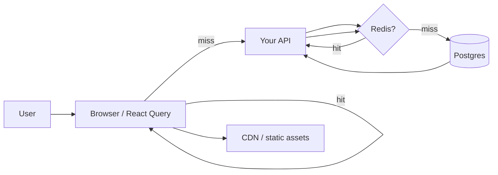

# 08 — Caching: Redis, CDN & Redux (Not the Same Beast)

People say "cache" like it's one spice. It's **four kitchens** pretending to be one pantry.

---

## Why caching exists (the human reason)

Every click that hits Postgres costs **time and money**. Caching answers: **"Can we reuse an answer we already computed?"**

Good caching = app feels instant. Bad caching = "I saved but it still shows the old logo" — designers feel this in their soul.

---

## 1. Server-side cache (Redis and friends)

**Redis** = in-memory key-value store, absurdly fast, lives near your API (same region, private network).

**Pattern: cache-aside** (the classic)

```
1. API gets request for dashboard:user_9f2
2. Check Redis key "dashboard:user_9f2"
   → HIT: return cached JSON (often <5ms)
   → MISS: query Postgres, build JSON, SET key with TTL 60s, return
3. Next 60 seconds of identical requests skip the DB
```

**TTL** (time to live) = auto-delete after N seconds so you don't serve 2019 pricing forever.

| Concept | Plain English |
|---------|----------------|
| **Hit** | Found in cache — happy path |
| **Miss** | Not found — pay the DB tax once |
| **Invalidation** | Delete/update keys when data changes ("user updated avatar → bust cache") |
| **Thundering herd** | Cache expires, 10k users miss at once → DB cries. Fix: stagger TTL, single-flight lock |

**What Redis is good for beyond JSON blobs:**

- Session storage ("who is logged in")
- Rate limiting ("max 100 req/min per IP")
- Leaderboards, counters
- Pub/sub for realtime fan-out (with caveats)

**What Redis is NOT:** your ledger of record. If Redis dies and you lose payment state, you had a design problem.

**Alternatives:** Memcached (simpler), **Valkey** (Redis fork), **Upstash** (serverless Redis — pay per request, great for side projects).

---

## 2. HTTP cache & CDN (edge layer)

Browsers and **CDNs** (CloudFront, Cloudflare, Vercel Edge) cache **HTTP responses** using headers the backend sets.

```
Cache-Control: public, max-age=3600
ETag: "abc123"
```

| Header vibe | Meaning |
|-------------|---------|
| `max-age` | "Browser, reuse this for N seconds" |
| `s-maxage` | Same but for shared CDN caches |
| `no-store` | Never cache (banking, personalized health data) |
| `stale-while-revalidate` | "Show old while fetching fresh in background" |

**CDN** = copies of static files (JS bundles, images, fonts) in **edge POPs** worldwide. User in Delhi hits Mumbai-ish edge, not Virginia.

**Improves UX by:** repeat visits feel instant; your origin server sleeps.

**Designer pain point:** deploy new hero image but CDN still serves old file → **cache bust** with `hero.webp?v=20260328` or purge CDN in dashboard.

**API JSON caching at CDN:** only for **public, same-for-everyone** endpoints. Never CDN-cache personalized `/me` without careful rules.

---

## 3. Client-side data cache (React Query, SWR, Apollo)

Lives **in the browser tab memory**. Not Redis. Not CDN.

**Stale-while-revalidate** (TanStack Query's religion):

1. Paint UI from **last visit's data** immediately (feels fast)
2. Fetch fresh data in background
3. Swap in updates if something changed

| Tool | Best for |
|------|----------|
| **TanStack Query (React Query)** | Server state — lists, detail pages, pagination |
| **SWR** | Same energy, lighter API surface |
| **Apollo Client** | GraphQL-heavy apps |
| **Redux / Zustand** | **UI state** — modals, wizard step, theme, selections |

**Optimistic updates:** UI shows "Saved ✓" before server responds; rolls back if server says no. Magic when it works, trust issues when it doesn't.

**Redux is not Redis.** Redux doesn't stop DB meltdown. It organizes **frontend brain** and sometimes mirrors server data (often better delegated to React Query now).

---

## 4. Build-time & asset caching (easy to forget)

- **Next.js / bundlers** hash filenames (`app.a8f3.js`) so CDN caches **forever** safely — new deploy = new filename.
- **Service workers** (PWA) can cache offline shells — another stale-data gremlin if misconfigured.

---

## How the layers stack (one user journey)



---

## Debugging "wrong data on screen"

| Symptom | Suspect first |
|---------|----------------|
| Only you, after save | Client cache / optimistic UI |
| Everyone, static asset | CDN or browser cache |
| Everyone, API payload | Server cache (Redis) or DB actually wrong |
| Intermittent | TTL expiry, thundering herd |

Standup magic question: **"Which layer is stale — browser, CDN, Redis, or DB?"**

---

## Builder takeaway

| Layer | Where | Buys you |
|-------|-------|----------|
| Redis | Server | DB breathing room, speed on hot reads |
| CDN | Edge | Global asset speed |
| React Query | Browser | Perceived speed, less spinner trauma |
| Redux/Zustand | Browser | UI state, not infrastructure |

Next: [09-pick-your-stack-players.md](./09-pick-your-stack-players.md) — who sells each layer.
