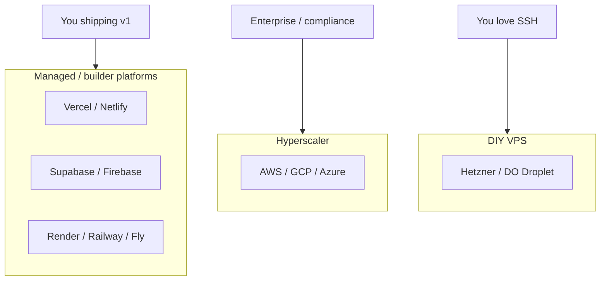

# 09 — Who Sells What: AWS Scale vs Indie-Friendly

Picking infra is like picking a neighborhood: **school district (compliance), commute (latency), rent (baseline cost), and whether you need a doorman (support).**

---

## The three tiers (mental model)

---

## Hyperscaler: **AWS** (and GCP, Azure)

**AWS** = everything bagel. You can run a lemonade stand and a airline on the same account (please don't use one account for both).

| You want… | AWS thing | Notes |
|-----------|-----------|--------|
| Virtual machines | **EC2** | Raw Linux boxes — you patch, you cry |
| Serverless functions | **Lambda** | Event-driven, cold starts, IAM fun |
| Object storage | **S3** | Industry default for files |
| Managed Postgres | **RDS** | Backups, failover options |
| CDN | **CloudFront** | Pairs with S3 |
| Load balancing | **ALB** | Routes traffic across instances |
| Queues | **SQS** | Decouple webhook bursts |
| Secrets | **Secrets Manager** | Not `.env` in git |
| Container orchestration | **ECS / EKS** | Kubernetes when you hire adults |

**When AWS wins:** regulated industries, multi-region SLAs, existing AWS enterprise agreement, need obscure services (Kinesis, SageMaker at scale), dedicated infra team.

**When AWS hurts:** solo builder paying for NAT Gateway memes, learning IAM instead of shipping, invoice shock at 3am.

**GCP** — strong data/ML, Firebase family, BigQuery cult. **Azure** — Microsoft shops, .NET gravity.

---

## Indie / builder-friendly (lower ceremony)

These **hide** VPCs and patch Tuesday. You get dashboards and env var text boxes.

### Frontend & edge

| Player | Sweet spot | Watch out for |
|--------|------------|---------------|
| **Vercel** | Next.js, preview URLs per PR, serverless API routes | Vendor cozy with Next; heavy backend elsewhere |
| **Netlify** | Static sites, forms, functions | Same family as Vercel |
| **Cloudflare Pages** | Static + Workers at edge | Different pricing vibe |

### Backend + database bundles

| Player | Sweet spot | Watch out for |
|--------|------------|---------------|
| **Supabase** | Postgres + auth + storage + realtime | You still think in SQL |
| **Firebase** | Mobile-first, auth, Firestore, push | Document model, Google rules |
| **Neon / PlanetScale** | Managed SQL without full BaaS | Bring your own API |

### Always-on apps (API, workers, cron)

| Player | Sweet spot | Watch out for |
|--------|------------|---------------|
| **Render** | Web service + worker + cron, simple mental model | Cold free tier spin-down |
| **Railway** | Containers + DB plugins, fast DX | Usage-based bill |
| **Fly.io** | Run close to users globally | More knobs than Render |

### Storage, cache, email, money

| Need | Indie picks |
|------|-------------|
| Cheap S3-like storage | **Cloudflare R2**, DO Spaces |
| Redis without babysitting | **Upstash** |
| Transactional email | **Resend**, Postmark, SendGrid |
| Payments | **Stripe** (test vs live keys per env — [chapter 13](./13-environments-secrets.md)) |
| Auth (don't roll crypto) | Clerk, Auth0, Supabase Auth, Firebase Auth |
| Error tracking | Sentry |
| Logs / uptime | Better Stack, Datadog (when you grow up) |

### Domains & DNS

**Cloudflare**, Namecheap, Google Domains successors — buy domain, point **DNS** A/CNAME records at Vercel or Railway. "Why isn't my deploy live?" is DNS 40% of the time.

---

## Decision cheat sheet (expanded)

| Situation | Lean toward | Why |
|-----------|-------------|-----|
| Marketing site + blog | Vercel / Netlify / Pages | Zero server babysitting |
| SaaS MVP with users + SQL | Supabase + Vercel or Railway API | Auth and DB day one |
| WebSockets + job queue | Railway / Render persistent service | Serverless isn't home |
| Mobile app + push + offline | Firebase | Integrated mobile story |
| Client mandates "cloud" | AWS/GCP with consultant | Politics + compliance |
| EU data residency | EU region on any host + legal review | Not just checkbox |
| Predictable $20/mo side project | Render free/cheap, Supabase free tier | Until success punishes you |

**Real migration arc:** Supabase + Vercel → background worker on Railway → Redis (Upstash) → "we should talk about AWS" when revenue and pain justify headcount.

---

## Regions & latency

Data lives in a **region** (`ap-south-1` Mumbai, `eu-west-1` Ireland). Users far from region feel lag on **dynamic** API calls; **CDN** fixes static assets, not uncached SQL.

Pick region close to **users** or **legal requirement** — not where you vacation.

---

## Cost philosophy (honest)

| Model | You pay when… | Feels like |
|-------|----------------|------------|
| Serverless / usage | Traffic spikes | Catering bill |
| Persistent always-on | Calendar month | Chef salary |
| AWS microservices | Traffic + misconfig | Leased building + hidden fees |

**Free tiers** are marketing. Plan for **first paying customer** pricing, not forever-free.

---

## Observability (when things break at 2am)

Someone needs to see **logs, errors, traces**. Indie: Sentry + host logs. AWS: CloudWatch + X-Ray + $$$. You don't need this on day one — you need it before **first big launch**.

---

## Builder takeaway

- **Prototype:** managed platforms (Vercel + Supabase/Railway).
- **Scale / compliance:** hyperscaler + team.
- **Never choose AWS because it sounds serious** — choose it when requirements are serious.

Next: [10-microservices-docker-cicd.md](./10-microservices-docker-cicd.md) — shipping code, not just hosting it.
