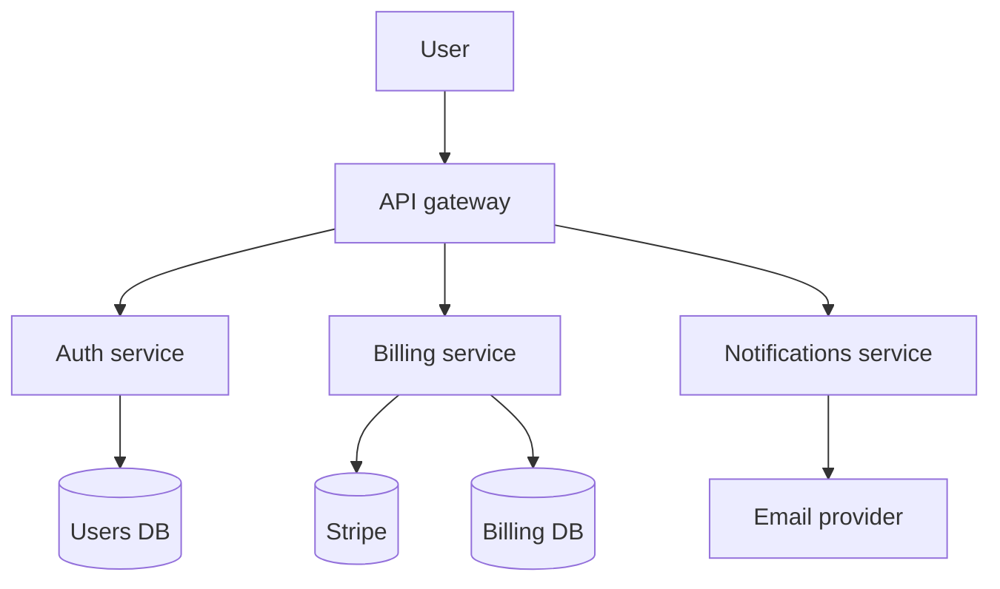
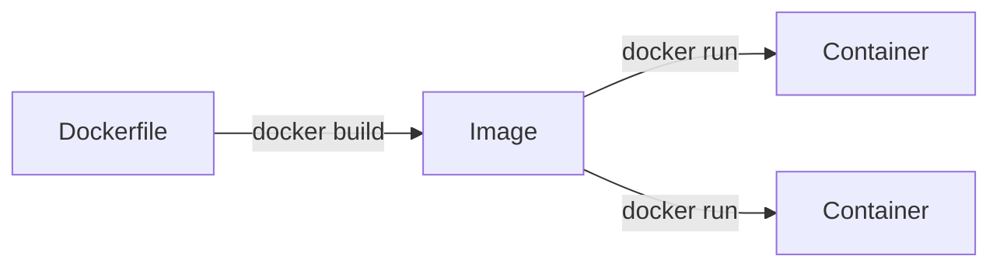
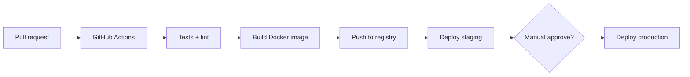

# 10 — Microservices, Docker & CI/CD (DevOps for Humans)

This chapter is **how code becomes running software**. Environments (staging vs prod) and secrets get their own chapter — [13-environments-secrets.md](./13-environments-secrets.md). Git workflow — [12-git-github-workflow.md](./12-git-github-workflow.md).

---

## Microservices: what they actually mean

**Monolith:** one repo, one deployable — apps, API, background jobs in **one kitchen**.

**Microservices:** many small deployables, each owns one job, talk over network.

**Why teams split:**

- Ship billing without redeploying chat
- Scale hot services independently
- Different teams, different release cadences

**Why it's overkill early:**

- "Login broken" — which of 14 services?
- Distributed transactions (refund + inventory) become sagas and therapy
- Need **logging, tracing, on-call**

**Vibe coder rule:** monolith (or monolith + one worker) until split pain **exceeds** monolith pain. Not because Netflix did it.

**Modular monolith:** one deploy, **clean internal folders** (`/billing`, `/users`) — cheat code for later splits.

---

## Docker containers: lunchboxes for code

**Problem:** works on your Mac, dies on Linux server — Node version, missing lib, wrong env.

**Image** = frozen recipe (OS slice + runtime + your code).  
**Container** = running instance of that image.

**Dockerfile** — instructions (`FROM node:20`, `COPY .`, `CMD`).  
**docker compose** — run app + Postgres + Redis locally with one command.

Metaphor: **meal prep container**. Staging and prod eat the same lasagna; only the **seasoning** (env vars) changes.

Railway, Render, Fly, ECS — they run **your image**. You stop SSH-ing `npm install` on prod.

**Kubernetes (K8s):** orchestra for **many** containers across **many** machines. Overkill until you have a platform team or serious scale. Know the word; don't volunteer.

---

## CI/CD: robots that gate and ship

| Term | Meaning |
|------|---------|
| **CI** (Continuous Integration) | Every push/PR: install, lint, test, build — "would main explode?" |
| **CD** (Continuous Delivery) | Green build → **ready** to deploy (human clicks) |
| **CD** (Continuous Deployment) | Green build → **auto** deploy (no human) |

Typical pipeline:

**What runs in CI:**

- Unit tests, typecheck (`tsc`)
- Lint/format (ESLint, Prettier)
- Build (`next build`, `go build`)
- Sometimes E2E (Playwright) on staging URL

**Preview deploys:** Vercel/Netlify comment a **unique URL on every PR** — design review on real HTTPS, not localhost cosplay.

**Branch protection:** `main` requires PR + passing checks — admins merge ([chapter 12](./12-git-github-workflow.md)).

---

## Deploy strategies (basics)

| Strategy | Vibe |
|----------|------|
| **Rolling** | Replace instances one by one — default on many platforms |
| **Blue/green** | Two prod environments; flip traffic — fast rollback |
| **Canary** | 5% users get new version first — watch error rate |

**Health checks:** load balancer pings `/health` — unhealthy instance gets yeeted before users notice (hopefully).

---

## DevOps words you'll hear in standup

| Word | Meaning |
|------|---------|
| **IaC** (Infrastructure as Code) | Terraform/Pulumi — servers defined in files, not click-ops |
| **Registry** | Where Docker images live (GHCR, ECR) |
| **Artifact** | Built output (`.zip`, image) CI produces |
| **Pipeline** | The whole CI/CD chain |
| **Rollback** | Deploy previous known-good version |

You don't need Terraform for your first SaaS. You need **git → CI → staging → prod** with **different env vars**.

---

## Builder takeaway

- **Microservices** = organizational scale tool, not starter pack.
- **Docker** = same binary everywhere.
- **CI/CD** = automated "does it build?" + "ship it safely."

Next: [11-integrations.md](./11-integrations.md) — talking to Stripe, Slack, and robots.
