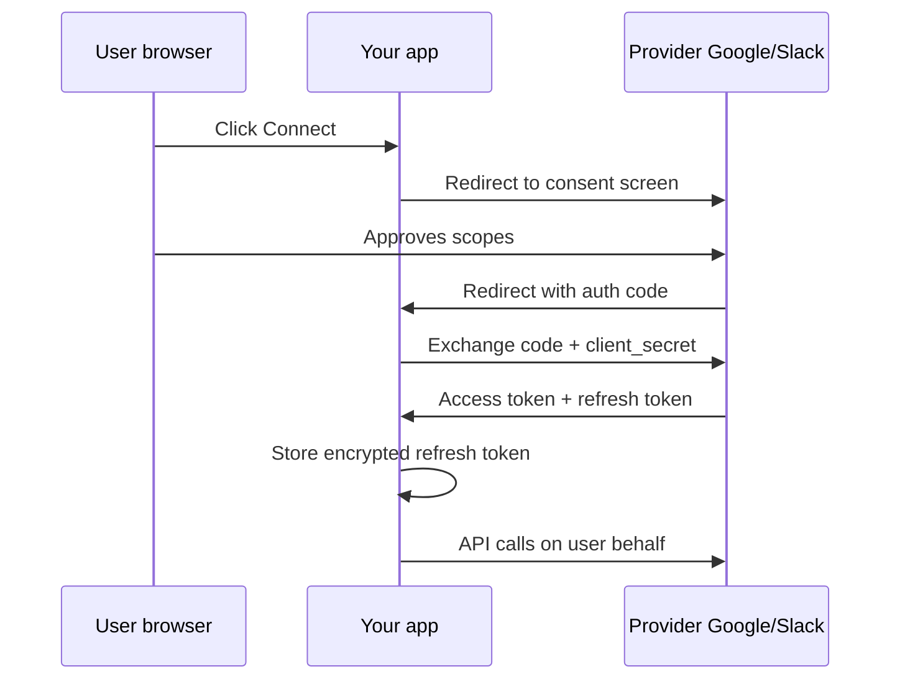
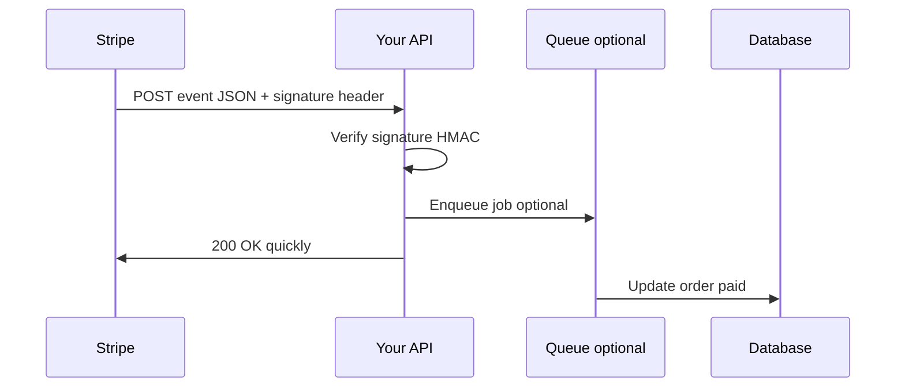

# 11 — Integrations: Webhooks, OAuth & MCP

Your app is the hub. Everyone else — payments, email, calendars, AI — is a **spoke**. Integrations are the contracts between them.

---

## Three patterns (memorize)

| Pattern | Direction | Who drives | Example |
|---------|-----------|------------|---------|
| **API call** | You → them | Your backend | Create Stripe Checkout Session |
| **Webhook** | Them → you | Their servers | `payment_intent.succeeded` POST to you |
| **OAuth** | User + both apps | User consent flow | "Connect Google Calendar" |

Most products = **API out, webhooks in, OAuth for user-linked accounts.**

---

## REST integrations (you call them)

Your BE holds **API keys** or **OAuth access tokens** in env vars ([chapter 13](./13-environments-secrets.md)).

```
FE → your API → Stripe API (server-side secret key)
FE → your API → OpenAI API
FE → your API → Slack API (bot token)
```

**Never** put secret keys in frontend bundle — users can read every byte of JS. Publishable keys (Stripe `pk_`) only where docs allow.

**Rate limits:** vendors cap requests/min — handle `429` with backoff. **Idempotency keys** on POST (Stripe): same key = same charge, safe to retry.

**Retries:** network blips happen — retry **GET** freely; retry **POST** only with idempotency.

---

## OAuth: AuthN vs AuthZ (again, with teeth)

| | **Authentication** | **Authorization** |
|---|---------------------|-------------------|
| Question | Who are you? | What can you access? |
| UX | "Sign in with Google" | "Allow us to read your Notion pages?" |

**OAuth 2.0 flow (simplified):**



**Critical:** `client_secret` exchange happens **only on your backend**. Frontend gets short-lived tokens or session cookies — not the master keys.

**Scopes:** `read:email` vs `write:calendar` — ask minimum needed (users distrust "full account access").

**JWT** (JSON Web Token): signed payload your API trusts (`sub: user_123`). Used in SPAs + mobile. **Session cookie:** server stores session ID; cookie auto-sent by browser.

---

## Webhooks: they call your kitchen

You register a **webhook URL** in their dashboard: `https://api.yourapp.com/webhooks/stripe`



**Verify signatures** — Stripe `Stripe-Signature`, GitHub `X-Hub-Signature-256`. Without verification, randos POST fake "payment succeeded."

**Respond fast:** heavy work goes to **queue** (Redis, SQS) — webhook handler acknowledges in <5s or vendor retries.

**Idempotency:** same event ID may arrive twice — store processed event IDs or upsert safely.

**Webhook vs API endpoint:**

| | API endpoint | Webhook URL |
|---|--------------|-------------|
| You | Call them when you need | They call you when something happens |
| Discovery | Their docs | You give them your URL |
| Auth | Your API key to them | Their signature on incoming POST |

---

## Zapier, Make, n8n (no-code integrations)

Same physics: triggers (webhook, poll) → actions (create row, send Slack). Good for ops; prod-critical flows usually belong in **your** BE with tests.

---

## MCP (Model Context Protocol)

**USB-C for AI tools.** An **MCP server** exposes typed **tools** (search docs, create issue); **MCP client** (Cursor, Claude Desktop) calls them.

Not a replacement for your public REST API. It's for **dev/agent workflows**:

- Read design tokens from repo
- File Linear ticket from IDE
- Query internal runbook

**Security:** separate MCP credentials from prod DB god-mode. Read-only where possible. Same least-privilege brain as OAuth scopes.

---

## API key vs OAuth (when building integrations)

| | API key | OAuth |
|---|---------|-------|
| Best for | Server automation, single admin | Per-user "connect my account" |
| Revoke | Rotate one key | Per-user disconnect |
| Leak blast radius | Often huge | Scoped to user + scopes |

---

## Failure modes (integration edition)

| Symptom | Likely cause |
|---------|----------------|
| Works locally, fails prod | Wrong env key (test vs live) |
| Webhook never fires | URL wrong, not HTTPS, firewall |
| Duplicate charges / emails | Missing idempotency |
| OAuth "redirect_uri mismatch" | Typo in provider console vs your URL |

---

## Builder takeaway

- **API out** with secrets on server only.
- **Webhooks in** with signature verify + fast 200.
- **OAuth** when the integration is **per user**, not per company.

Next: [12-git-github-workflow.md](./12-git-github-workflow.md) — branches, PRs, merge vs rebase vs squash.
