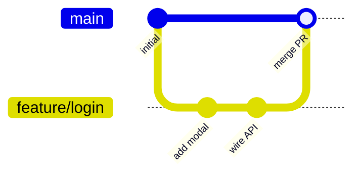
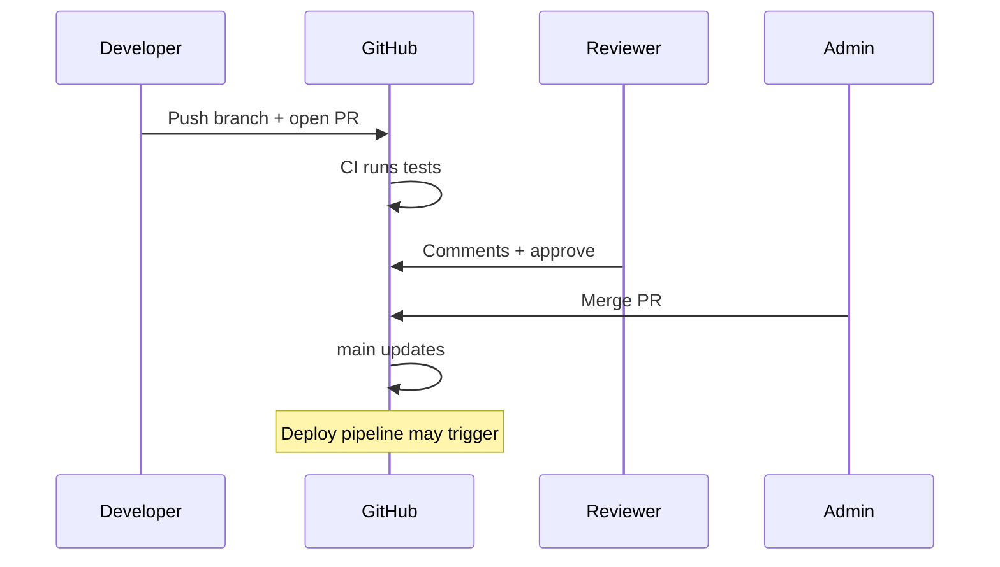

# 12 — Git & GitHub: Branches, PRs, Merge vs Rebase vs Squash

Git is **time travel for files**. GitHub is **Git with a social network and permission buttons** so teams don't overwrite each other like savages.

---

## Core objects (minimum viable mental model)

| Thing | Metaphor |
|-------|----------|
| **Repository (repo)** | Project folder + full history |
| **Commit** | Saved snapshot with message ("Fix checkout button padding") |
| **Branch** | Movable label pointing at a line of commits |
| **`main`** | The branch everyone treats as **production source of truth** |
| **Remote (`origin`)** | Copy on GitHub — collaboration hub |
| **Clone** | Download repo + history to your machine |
| **Fork** | Your copy of **someone else's** repo under your account — open source contribution pattern |



---

## Daily commands (what they actually do)

```bash
git checkout main          # switch to main branch (or: git switch main)
git pull origin main       # fetch + merge latest main from GitHub
git checkout -b fix/typo   # create + switch to small branch
# ... edit files ...
git add README.md          # stage changes
git commit -m "Fix typo in readme"
git push -u origin fix/typo
```

**Small branches** = one idea per branch (`fix/header-alignment`, `feat/export-csv`). Easier review, easier rollback. Not `jason-wednesday`.

---

## Fork vs clone (don't mix these up)

| | **Clone** | **Fork** |
|---|-----------|----------|
| Whose repo | One you have access to | Copy of another user's/org repo |
| Use case | Your team project | Contribute to open source |
| Flow | Branch → PR on same repo | Fork → branch on your fork → PR **upstream** |

Your **how-the-internet-works** repo: you **clone** `theanimatedmonk/how-the-internet-works`. You don't fork your own project unless you're weird.

---

## Pull requests (PRs)

A **PR** says: "Please merge my branch into `main`."



**Roles:**

- **Author** — writes code, responds to feedback
- **Reviewer** — reads diff, asks questions, approves
- **Admin / maintainer** — merge button, branch protection, repo settings

**Draft PR** — "not ready but want eyes." **Review requested** — ping specific humans.

**Checks** — green CI required before merge (see [chapter 10](./10-microservices-docker-cicd.md)).

---

## Merge strategies (the three buttons)

When PR is approved, GitHub offers how to combine history:

### 1. Merge commit (classic)

Creates a merge commit on `main` — branch history preserved.

```
main:     A --- B ------------- M
               \               /
feature:        C --- D --- E
```

**Pros:** honest history, easy to revert whole feature.  
**Cons:** messy graph on busy repos.

### 2. Squash and merge

Squashes C+D+E into **one commit** on `main`.

**Pros:** `main` reads like a changelog — one PR = one commit.  
**Cons:** lose granular commits from branch (usually fine for vibe teams).

**Default recommendation for small teams:** squash merge + delete branch.

### 3. Rebase and merge (linear history)

Replays your commits on top of latest `main` — no merge commit, straight line.

**Pros:** pretty `git log`.  
**Cons:** can confuse if people already pulled your branch; rewrite history care.

---

## Rebase (the verb, not just the button)

**Rebase** = move your branch's commits to start from newer `main`.

```bash
git checkout feature/x
git fetch origin
git rebase origin/main
# fix conflicts if any
git push --force-with-lease
```

**Golden rule:** don't rebase commits **already shared** on a team branch unless everyone agreed. Fine on **your** feature branch before merge.

**Merge vs rebase philosophically:**

- **Merge** — "we combined two timelines."
- **Rebase** — "pretend I started from today's main."

---

## Worktrees (advanced but useful)

**Problem:** you're deep on `feature/big` but production bug needs hotfix on `main` — don't stash 47 files.

**Git worktree** = second folder on disk, **same repo**, different branch checked out.

```bash
git worktree add ../hotfix main
cd ../hotfix
# fix, commit, push, PR
git worktree remove ../hotfix
```

Metaphor: **two desks in the same office** — same filing cabinet (`.git`), different paper on each desk.

---

## Branch protection (why `main` isn't Wild West)

Admins enable on GitHub **Settings → Branches**:

- Require PR before merge
- Require approvals (1–2)
- Require status checks (CI green)
- Block force-push to `main`

**You** work on branches; **only CI + reviewers** touch `main` — that's how prod stays boring (good).

---

## Common pain & fixes

| Pain | Fix |
|------|-----|
| "Merge conflict" | Same lines edited — open file, pick changes, commit |
| "Push rejected" | Someone merged first — `git pull --rebase origin main`, push again |
| "Wrong branch" | `git stash`, checkout correct branch, `git stash pop` |
| Accidentally committed to main | Create branch from here, reset main (ask admin if shared) |

---

## Builder takeaway

1. **`main` is sacred** — branch for every change.
2. **Open PR early** — previews + CI.
3. **Squash merge** for clean history unless team says otherwise.
4. **Reviewers** catch bugs; **admins** merge when green.

Next: [13-environments-secrets.md](./13-environments-secrets.md) — staging, QA, prod, and why `.env` never goes to GitHub.
