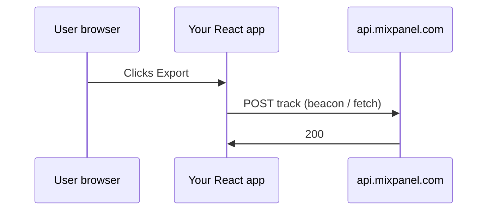
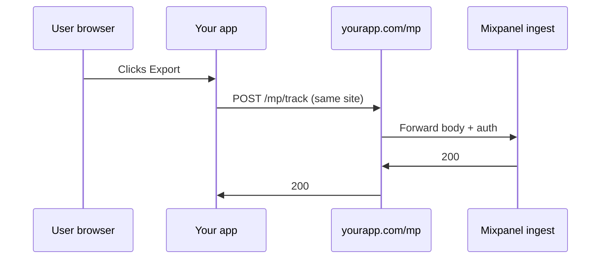
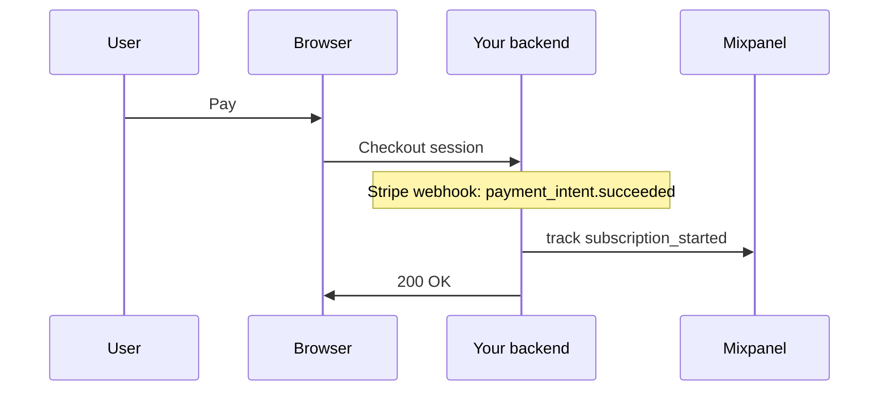

# 16 — Mixpanel & Product Analytics: Client, Proxy, Server

**UTMs** ([chapter 15](./15-utm-parameters.md)) tell you which **link** brought someone in. **Product analytics** (Mixpanel, PostHog, Amplitude, etc.) tells you what they **did** inside the app — signed up, exported PDF, rage-quit onboarding.

This chapter is **Mixpanel-shaped**, but the three-layer story — **browser → proxy → server** — is the same everywhere.

---

## What you’re actually sending

An **event** is a JSON-ish payload:

```json
{
  "event": "export_clicked",
  "properties": {
    "plan": "pro",
    "utm_source": "newsletter",
    "distinct_id": "user_9f2"
  }
}
```

Mixpanel stores events under a **project** (your product). A **project token** identifies which project gets the data — it’s not a password, but you still don’t sprinkle it in public GitHub gists.

**`distinct_id`** = who (anonymous device id before login, user id after). **`identify`** links the two when someone signs in.

Metaphor: **UTMs are how they found the restaurant. Events are what they ordered after they sat down.**

---

## Layer 1 — Client-side tracking (the default)

You add a snippet or npm package (`mixpanel-browser`) in the **frontend**. On button click or page view:

```javascript
import mixpanel from "mixpanel-browser";

mixpanel.init("YOUR_PROJECT_TOKEN", {
  track_pageview: true,
  persistence: "localStorage",
});

mixpanel.track("signup_started", { step: "email" });

// After login:
mixpanel.identify(user.id);
mixpanel.people.set({ $email: user.email }); // be careful with PII policies
```

**Flow:**



**Pros:** cheap to wire, rich **automatic** context (screen size, referrer, UTMs in URL).  
**Cons:** **ad blockers** and privacy extensions often block `mixpanel.com` scripts and beacons — you lose **20–40%+** of events in many audiences (developers, EU privacy nerds, anyone with uBlock).

**Don’t put in client events:** passwords, full credit card numbers, health data. Treat analytics like **a loud coffee shop** — assume the payload could leak to a screenshot.

---

## Why blocking happens (so you don’t blame Mixpanel)

Block lists target:

- Third-party domains (`api.mixpanel.com`, `cdn.mxpnl.com`)
- Known tracker script URLs
- `fetch` to analytics from the browser

The browser is **not a trusted telemetry pipe**. Marketing’s funnel will look “broken” even when the product is fine.

---

## Layer 2 — First-party proxy (sneak through your own domain)

**Idea:** the browser only talks to **`https://yourapp.com`** (or a subdomain you control). **Your server** (or edge) forwards the request to Mixpanel’s ingest API.



**Why it helps:** blockers focus on **third-party** tracker domains. A path on **your** origin looks like normal app traffic — not magic, but **materially more events captured**.

### Typical setup (Next.js / Vercel vibes)

**1. Init the browser SDK to hit your proxy:**

```javascript
mixpanel.init("YOUR_PROJECT_TOKEN", {
  api_host: "https://yourapp.com/mp", // first-party
  // or relative: "/mp"
});
```

**2. Reverse proxy / API route** forwards to Mixpanel:

```javascript
// app/api/mp/[...path]/route.js (conceptual)
export async function POST(req) {
  const body = await req.text();
  const url = `https://api.mixpanel.com/${req.nextUrl.pathname.replace("/api/mp/", "")}`;

  const res = await fetch(url, {
    method: "POST",
    headers: { "Content-Type": "application/json" },
    body,
  });

  return new Response(await res.text(), { status: res.status });
}
```

Or **nginx / Cloudflare Worker** rewrite — same physics.

**3. Optional:** serve the **loader script** from your domain too (some teams proxy `lib.min.js`). More setup, fewer script-blocking hits.

### Proxy hygiene

| Do | Don’t |
|----|--------|
| Rate-limit the proxy so randos can’t abuse your egress | Expose proxy without auth on a open API |
| Log failures server-side when forward breaks | Put **API secret** (export/delete) in the browser |
| Use HTTPS end-to-end | Proxy only in prod but forget staging |

**Witty metaphor:** client-side direct to Mixpanel is **shouting across a protest**. The proxy is **walking the note through your own lobby** — still ends up at the same inbox, but fewer bouncers stop it.

Mixpanel documents **reverse proxy / custom API host** patterns — search their docs for “api_host” and “self-hosted tracking”.

---

## Layer 3 — Server-side tracking (the adult table)

**Your backend** sends events — user never touches Mixpanel’s domain from the browser.

```javascript
// Node API — after payment really succeeded (Stripe webhook)
import Mixpanel from "mixpanel";

const mp = Mixpanel.init("YOUR_PROJECT_TOKEN");

mp.track("subscription_started", {
  distinct_id: userId,
  plan: "pro",
  mrr_cents: 4900,
  stripe_customer_id: customerId,
});
```

**Flow:**



**Use server-side for:**

- **Money truth** — `purchase_completed`, `refund` (never trust client-only revenue)
- **Webhook-driven** events ([chapter 11](./11-integrations.md))
- **Signup/login** if you want one canonical `distinct_id`
- **Anything blockers would eat** that leadership reads in board decks

**Server SDKs:** `mixpanel` (Node), or HTTP **/track** with form-encoded payload — same project token for ingest in most setups. **Service account / API secret** is for **export**, people profiles bulk ops, queries — keep on server only ([chapter 13](./13-environments-secrets.md)).

**Pros:** not blocked by browser extensions; aligns with **source of truth** in DB.  
**Cons:** no automatic device/referrer unless you **pass properties** from the client once or attach UTMs you stored at signup.

---

## Client + proxy + server together (sane default)

| Event type | Where to track | Why |
|------------|----------------|-----|
| Page views, button hovers, UI funnels | Client (via **proxy**) | Volume, friction, A/B UX |
| `signup_completed` | Server (or client + server dedupe) | Avoid fake signups |
| `payment_succeeded` | **Server only** | Stripe said so |
| Marketing UTMs | Client on first visit → **persist on user row** | Server events need attribution too |

**Double-counting:** if client **and** server both fire `purchase`, you get twins. Pick **one owner per event** or use the same `insert_id` / dedupe key if your tool supports it.

```text
Day 1 startup: client-only Mixpanel, cry at blockers
Week 4:        api_host → /mp proxy, funnel looks less sad
Month 3:       revenue events only from webhook → Mixpanel
```

---

## Identity: who is this human?

```javascript
// Before login — anonymous id (SDK generates)
mixpanel.track("onboarding_step", { step: 2 });

// After login — stitch sessions
mixpanel.identify("user_9f2");
mixpanel.track("onboarding_complete");
```

Server-side, pass the **same** `distinct_id` (your DB user id) on every call so web and API events land on one profile.

---

## Privacy & compliance (one paragraph, not legal advice)

- Cookie banners / consent in EU — client tracking often waits on **opt-in**
- **Server-side** doesn’t dodge GDPR; you’re still processing personal data
- Minimize PII in properties; hash or omit where possible
- Document events in a **tracking plan** so design doesn’t ship surprise surveillance

---

## Alternatives (same architecture)

| Tool | Client | Proxy | Server |
|------|--------|-------|--------|
| **Mixpanel** | mixpanel-browser | `api_host` custom | mixpanel Node |
| **PostHog** | posthog-js | reverse proxy in docs | posthog-node |
| **Amplitude** | amplitude-js | analytics proxy pattern | HTTP API |

Physics unchanged: **browser (leaky) → your domain (less leaky) → server (trustworthy for money).**

---

## Builder takeaway

- **Client tracking** = fast product insights, **incomplete** audiences.
- **Proxy** = send events through **your** URL so fewer blockers ghost you.
- **Server tracking** = billing, webhooks, and anything that must not lie.

Pair with [UTMs](./15-utm-parameters.md) on acquisition and **server events** on conversion — then the story from ad click to paid user is one narrative, not three fighting spreadsheets.

Back to [README.md](./README.md).