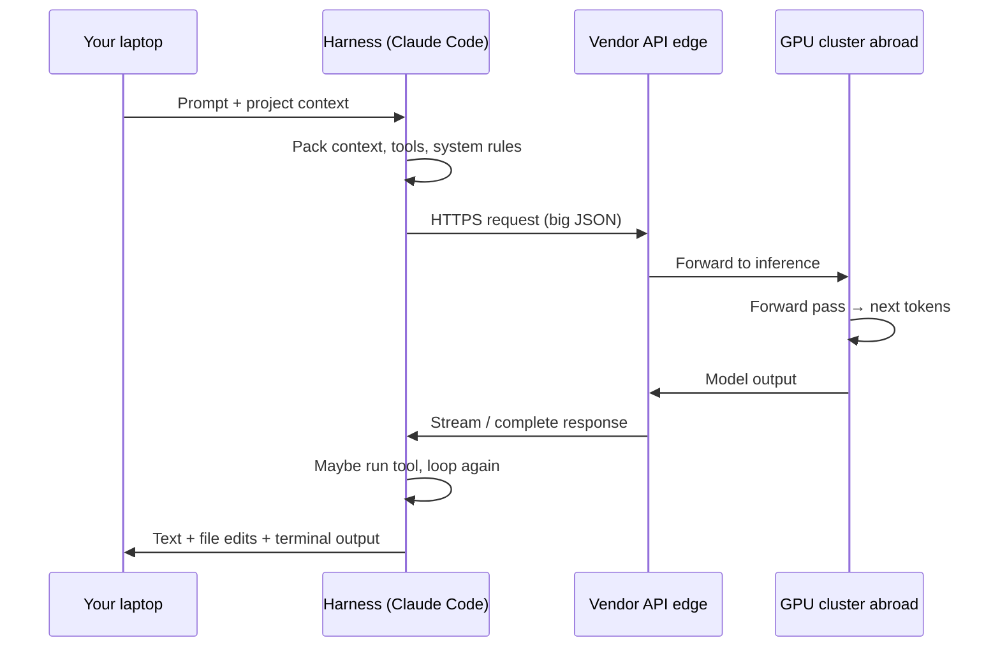
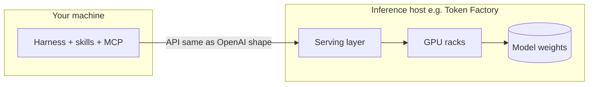

# AI 02 — Agents, Harnesses & Inference Hosts

**Chatbot** answers. **Agent** answers **and** does — runs commands, edits files, calls APIs, opens PRs.  
The model alone is a **mouth**. The **harness** is the **hands, passport, and todo list**.

---

## The formula

```text
Agent = LLM + Harness
```

| Piece | Job |
|-------|-----|
| **LLM** | Reason (statistically) over text; emit next tokens — maybe JSON for a tool call |
| **Harness** | Everything else: tools, MCP, skills, hooks, rules, sub-agents, memory, context packing |

**Harness examples (2025–2026 landscape):**

| Harness | Vibe |
|---------|------|
| **Claude Code** | Terminal/IDE agent; Anthropic models + tools baked in |
| **Codex / Cursor agent** | IDE-native loops, repo context, edits |
| **Hermes-style stacks** | More **pluggable** — swap underlying open or closed LLMs |
| **Custom scripts** | `while` loop + `fetch` + MCP — the “hand-woven” era ([AI 03](./03-rag-and-agent-loops.md)) |

Metaphor: **LLM is the chef**. **Harness is the kitchen, knives, health inspector, and expeditor.** Chef alone can only describe the dish.

---

## Closed stack: one trip to the cloud (e.g. Claude Code)

Start to finish when you hit Enter in Claude Code:



**Plain English:**

1. **Harness** on your Mac gathers files, git state, tool definitions, conversation history — trims to fit **context window**.
2. Request flies over the internet ([chapter 06](../06-how-fe-and-be-talk.md)) to the vendor’s **API**.
3. **GPUs in a data center** (often US/EU; depends on product & settings) run the **closed model weights** nobody downloads.
4. Tokens stream back; harness may **call a tool** (read file, bash, MCP) and **send another** request — a loop until “done.”

You never touch the weights. You rent **intelligence by the token**.

---

## Three-layer stack: open harness + regional inference

When you **don’t** send everything to Anthropic/OpenAI in California — e.g. you run **Hermes-like harness locally** but want **Indian GPUs** and an **open or regional model**:

```text
Harness (local) + Inference Host (GPU cloud) + LLM (weights) = Agent
```

| Layer | Lives where | Does what |
|-------|-------------|-----------|
| **Harness** (e.g. Hermes) | Your laptop or VPS | Skills, MCP, hooks, sub-agents, context window assembly |
| **Inference host** | GPU farm (e.g. **Sarvam Token Factory**-style) | Runs the model; bills **per token**; exposes OpenAI-compatible `/v1/chat/completions` often |
| **LLM** (e.g. GLM-5.x, Sarvam-105B-class) | Weights loaded **on those GPUs** | Forward pass: context in → tokens out |

**Is Token Factory “just a GPU farm”?**  
**Mostly yes** — with a **software hat**. Bare metal rental is “here’s an A100, SSH in.” An **inference host** adds: model serving, batching, autoscaling, API keys, routing, maybe compliance region. You’re buying **tokens**, not rack space — even though underneath it’s still **racks of GPUs drinking electricity**.



**Why bother:** data residency, latency, cost, or policy — “context never leaves India” while you still use a **familiar harness**.

---

## What is an “inference host”?

**Training** = bake the cake (weeks, millions of dollars, once).  
**Inference** = slice and serve (milliseconds, per request, forever).

An **inference host** is the **serving infrastructure** that:

- Loads weights into VRAM
- Accepts API requests with a **context window** (your prompt + docs + tool outputs)
- Returns generated tokens

Hyperscalers (AWS Bedrock, Azure OpenAI, Vertex) and **neoclouds** (CoreWeave, Nebius, Lambda, etc.) both sell this — different dress code, same physics ([AI 04](./04-gpus-datacenters-chips.md)).

---

## Examples: inference in practice

### Claude Code — one fix, two GPU bills

You: *“Fix the hydration warning in `Dashboard.tsx`.”*

| Step | What happens |
|------|----------------|
| 1 | Harness packs repo context + rules → ~**38k input tokens** |
| 2 | **Inference #1** on vendor GPUs → model suggests `Read` tool |
| 3 | Tool runs **on your machine** (not inference) |
| 4 | **Inference #2** with file contents in context → patch |

```text
Turn 1:  38k in + 400 out
Turn 2:  41k in + 1.2k out   ← tool loops are multiple taxi rides
```

### India stack — harness local, inference remote

```text
MacBook harness  --POST /v1/chat/completions-->  Token Factory GPUs
```

Same as [AI 08](./08-india-inference-token-factory.md): only **math** is regional; **eslint** on your CPU is not “inference.”

### Not inference

| Action | Bill |
|--------|------|
| Download Llama weights once | Storage / bandwidth |
| LoRA training Sunday night | Training GPU hours |
| `pnpm test` after agent edits | Your laptop |

---

## Tools, MCP — quick vocab

| Term | One line |
|------|----------|
| **Tool calling** | Model emits JSON: `run_sql({ readOnly: true })` |
| **MCP** | Standard plug for agents ↔ your services ([chapter 11](../11-integrations.md)) |
| **Sub-agents** | Harness spawns a researcher loop vs a coder loop |

The **LLM never had your private DB in training**. Tools and RAG **inject fresh facts** per turn.

---

## Rules — always-on instructions

Text injected **every turn**: `.cursor/rules/*.mdc`, `CLAUDE.md`, system prompts.

```markdown
# Example rule file
- Package manager: pnpm only.
- API keys: server env only, never client bundle.
- SQL: Prisma parameterized queries only.
```

Support agent rule:

```text
Never state refund amounts unless they appear in retrieved policy chunks.
If unsure → escalate_ticket tool.
```

Rules **suggest**; they lose to jailbreaks without **hooks** (below) and **evals** ([AI 07](./07-fine-tuning-evals-safety.md)).

---

## Skills — playbooks on demand

Folder + `SKILL.md` loaded when the task matches (“user said migration” → load `skills/db-migration/SKILL.md`).

```markdown
## DB migration skill (excerpt)
1. Staging only first.
2. No DROP without explicit user YES.
3. Run integration tests before prod summary.
```

| | **Rules** | **Skills** |
|---|-----------|------------|
| When | Every message | When relevant |
| Shape | Short constraints | Multi-step runbook |

---

## Hooks & harness guardrails — code that always runs

**Hooks** fire at lifecycle moments; many **guardrails** are implemented as hooks.

| Hook | Example |
|------|---------|
| `beforeSubmitToModel` | Strip `.env` from attached files |
| `beforeToolCall` | Block non–read-only SQL; require approval for `prod` bash |
| `afterToolCall` | Redact `Bearer ` / `sk_live_` from tool stdout |
| `onSessionStart` | Index git branch; list available skills |

### Example — `beforeToolCall` (pseudocode)

```javascript
function beforeToolCall({ name, args }) {
  if (name === "run_sql" && !args.readOnly) {
    throw new Error("This profile is read-only SQL");
  }
  if (name === "bash" && args.command.includes("prod")) {
    return { requireApproval: true };
  }
}
```

Hard blocks (often same layer): `rm -rf /` regex deny, max **25 tool calls**, allowlisted HTTP hosts only. Deeper **evals** for guardrails: [AI 07](./07-fine-tuning-evals-safety.md).

---

## Example: one agent turn (layers stacked)

```text
RULES → USER message → SKILL loaded → RAG chunks
  → INFERENCE → HOOK (no prod SQL) → TOOL (tests locally)
  → HOOK (redact keys) → INFERENCE again → CI evals on merge
```

---

## Builder takeaway

- **Agent** ≠ bigger model; **agent** = model + **loop** + **tools**.
- **Closed product:** harness + inference + weights = one bill, one plane ride overseas.
- **Open / regional:** harness local, **inference host** = GPU hotel, weights where you chose.

Next: [03-rag-and-agent-loops.md](./03-rag-and-agent-loops.md) — memory that isn’t made up.