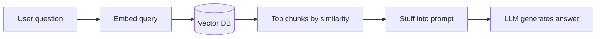

# AI 03 — RAG & Why Thin Loops Beat Fat Frameworks

---

## RAG in one breath

**RAG** = **Retrieval-Augmented Generation**.

The model’s training data is **stale and generic**. RAG says: **before you answer, go read our docs.**



Metaphor: open-book exam. Without RAG = closed-book hallucination festival. With RAG = **allowed cheat sheet**, if chunking didn’t screw you.

---

## Chunks and vectors

1. Split documents into **chunks** (paragraphs, sections, pages-if-you-dare).
2. Run each chunk through an **embedding model** → fixed-size **vector** (list of numbers).
3. Store in a **vector DB** (Pinecone, pgvector, Qdrant, Weaviate, etc.).

On a question:

1. Embed the **user query** → vector `q`.
2. Find stored vectors **closest** to `q` — usually **cosine similarity** (angle between arrows in high-dimensional space).
3. Paste winning chunks into the prompt: *“Use only this context: …”*

**Cosine similarity** — same direction = related text, even if wording differs. Not magic; **geometry cosplay**.

---

## Chunking is where RAG goes to therapy

Bad chunks = right-ish retrieval, wrong answer.

| Problem | Symptom |
|---------|---------|
| Chunk too big | Noise drowns the one sentence that matters |
| Chunk too small | Sentence cut in half; “refund policy” loses “except annual plans” |
| Tables / code split wrong | Model invents the missing half |

**Techniques teams use:**

| Technique | Idea |
|-----------|------|
| **Overlapping chunks** | Sliding window — last 100 tokens repeat in next chunk so boundaries survive |
| **Semantic chunking** | Split on headings/paragraphs, not arbitrary token count |
| **Parent–child** | Retrieve small chunk, inject **parent section** for context |
| **Query-based / Q&A indexing** | Pre-generate **“Q: How do refunds work? A: …”** pairs from docs; embed **questions**; user query matches stored Q better than raw prose |

Metaphor: **shredding the employee handbook**. Overlap = sticky notes between strips. Q&A indexing = **FAQ cards** instead of random shredder confetti.

---

## LangChain, LangGraph, and the abstraction hangover

~2023:** “We need **LangChain** for agents!”** — chains, memory, retrievers, 47 abstractions.

~2025–2026:** Models got **better at following instructions** and **native tool calling**. Harnesses (Claude Code, Cursor, custom loops) ship **opinionated** agent loops. Teams notice:

```text
LangChain graph + debug + version skew  >  while (tool_calls) { call API; run tool; }
```

**Why the shift:**

| Then | Now |
|------|-----|
| Models needed heavy scaffolding to “act” | Frontier + open models emit tool JSON reliably-ish |
| Everyone rebuilt the same 40-line loop in DAG form | **Hand-woven loop** in your API route is readable in standup |
| Framework = faster MVP | Framework = **operational overhead** (deps, breaking changes, opaque traces) |

Not “never use LangChain” — use it when **orchestration complexity** earns its rent (durable workflows, human-in-loop graphs). For many products: **thin harness + good prompts + RAG** wins.

---

## Hand-woven agent loop (pseudocode)

```javascript
let messages = [{ role: "user", content: question }];

for (let step = 0; step < MAX_STEPS; step++) {
  const res = await llm.chat({ messages, tools });
  if (res.finish_reason === "stop") return res.text;

  const toolResult = await runTool(res.tool_call);
  messages.push(res.assistant_message, toolResult);
}
```

That’s the agent. Everything else is **ergonomics and liability insurance**.

---

## Builder takeaway

- **RAG** = retrieve chunks → augment prompt → generate.
- **Chunking** is the product; the vector DB is the filing cabinet.
- **Fat frameworks** optional; **good loops + models + tools** are the default modern stack.

Next: [04-gpus-datacenters-chips.md](./04-gpus-datacenters-chips.md) — where the tokens actually get cooked.