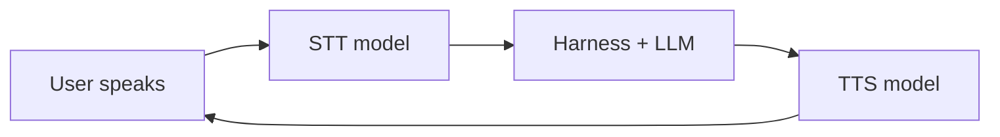

# AI 06 — STT, TTS & Why Voice Has Its Own Stack

Agents aren’t only typed. **Voice** = **speech in** (STT) and **speech out** (TTS). Different models, different failure modes, different **India-specific** heroes.

---

## STT — speech-to-text

**STT** = audio waveform → **text transcript**.

Pipeline (simplified):

```text
Mic audio  →  feature extraction  →  acoustic model  →  text (+ punctuation sometimes)
```

**Uses:** meeting notes, voice assistants, **call center analytics**, dubbing subtitles, “talk to my agent.”

**Pain points:**

| Issue | Reality |
|-------|---------|
| Accents & code-switching | English + Hindi + Tanglish in one sentence breaks naive models |
| Noise | Cafés, fans, Zoom compression |
| Latency | Real-time agents need **streaming** STT (partial transcripts) |
| Privacy | Audio may be **more sensitive** than chat logs |

Metaphor: STT is **the stenographer** in the courtroom. If they mishear “ship” vs “chip,” the whole agent chain lies confidently.

---

## TTS — text-to-speech

**TTS** = text → **audio**.

Modern stack is often **neural** (not robotic 2010 voice): models predict **mel spectrograms** or audio tokens, then vocoder to waveform.

**Uses:** IVR, accessibility, **voice agents** that talk back, content narration.

**Knobs you care about:**

- **Voice identity** (brand voice, speaker ID)  
- **Prosody** (does it sound like a human or a GPS?)  
- **Language / dialect** — one “English” button isn’t enough for India  
- **Latency & cost** — per character or per second priced  

---

## How voice fits the agent stack



The **LLM** still reasons in **text**. STT/TTS are **adapters** — unless you use newer **native audio** models (frontier multimodal), which blur the line but still sit on GPUs somewhere.

For builders: treat voice as **two extra API calls** with **SLA** and **fallback to text** when STT confidence is low.

---

## What Sarvam has been building (surface picture)

**[Sarvam AI](https://www.sarvam.ai/)** (India) focuses on **Indian languages and voice** — not trying to be “generic US English chatbot #4000.”

Themes you’ll see in their story:

| Area | What it means for builders |
|------|----------------------------|
| **Indic STT / TTS** | Models tuned for **Hindi, Tamil, Telugu**, etc. and **code-mixed** speech |
| **Product APIs** | Voice bots, translation, text-to-speech for **local apps and government/enterprise** |
| **Open / partner models** | Releasing or hosting **speech and LLM** weights aimed at **India latency & compliance** |
| **Bulbul and speech SKUs** | Named TTS/voice products — “sounds local,” not imported accent cosplay |

**Why a regional player exists:**  
US-centric STT often **wrecked** on Indian accents; TTS sounded **imported**. Sarvam bets **data + evaluation in the wild** (call centers, UPI voice, regional apps) beats slap-on-whisper.

Pair with [AI 08](./08-india-inference-token-factory.md): **Sarvam models on Indian GPUs** = voice + text without round-tripping prompts to Virginia.

---

## Open vs closed voice

| | Open-ish (self-host) | API (closed hosted) |
|---|----------------------|---------------------|
| Examples | Whisper derivatives, open TTS research weights | ElevenLabs, PlayHT, cloud STT |
| Win | Data stays in VPC | Quality + zero ML ops |
| Risk | You tune and fix accents | Bill and vendor lock |

**Sarvam’s lane:** hosted **Indian voice** APIs + models enterprises can adopt without building speech research in-house.

---

## Builder takeaway

- **STT** = ears. **TTS** = mouth. **LLM** = brain in the middle.  
- India needs **Indic-first** speech, not bolt-on English.  
- **Sarvam** = regional speech + LLM story; wire it like any API — keys in env, not client ([chapter 13](../13-environments-secrets.md)).

Next: [07-fine-tuning-evals-safety.md](./07-fine-tuning-evals-safety.md) — before you ship the agent to customers.